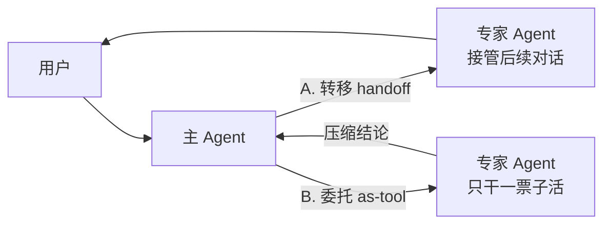

# 多 Agent 协作产品的设计方案调研报告（产品视角）

> 作者：Product Manager（ACowork）
> 日期：2026-03
> 定位：面向「多 Agent 协作」软件产品的**设计方案层**横向调研，用于 ACowork 的产品决策与架构取舍
> 覆盖对象：OpenAI Swarm/Agents SDK、LangGraph/LangChain Multi-Agent、AutoGen/AutoGPT、CrewAI、MetaGPT、Claude（Research / Subagents / Agent Teams）、Google ADK、A2A / AG-UI / MCP 协议层，以及国内外主流多 Agent 协作应用（Coze、Dify、Manus、Agentforce、Cursor、Devin）

---

## 0. 阅读指引

本报告回答的不是「哪个框架更强」，而是四个产品决策问题：

1. **市场已经收敛出哪几种设计范式？**（共性）
2. **这些范式在什么场景下各自会赢/会输？**（差异）
3. **过去 18 个月的设计重心往哪儿移动？**（趋势）
4. **ACowork 应该抄什么、不该抄什么？**（可借鉴点）

每个被调研产品都按任务要求的 **6 个维度** 展开：角色划分 / 协作编排 / 任务分发与通信 / 人机介入点 / 状态与记忆 / 落地场景与卖点。第 3 章给出总表，第 4 章给出逐产品证据。

---

## 1. 结论先行

### 1.1 一句话结论

> **多 Agent 协作已经从「让一群 Agent 自由聊天」收敛为「一个确定性的编排骨架 + 若干隔离上下文的专家执行单元 + 可中断的检查点」**。角色可以是预定义、也可以是运行时动态生成，但**协作的控制流必须落到可观测、可回放、可审批的确定性载体上**（LangGraph 的 StateGraph、CrewAI 的 Flow、ACowork 的 Session/Intent 管线）。所有成熟产品都在做同一件事：**把「多 Agent」从演示形态变成可交付的工程形态**。

### 1.2 六大共性范式（市场收敛结果）

| # | 共性范式 | 一句话概括 | 代表实现 |
|---|---|---|---|
| C1 | **Agent = 指令 + 工具 + 上下文窗口** | 不论叫什么名字，Agent 的最小单元都是「系统提示 + 可用工具集 + 一个（通常是私有的）上下文窗口」 | OpenAI Agents SDK、Claude Code Subagents、ADK `LlmAgent` |
| C2 | **编排与执行分离** | 主流做法是把「谁先谁后、谁能找谁」交给一个显式编排器（Supervisor / Graph / Flow / Sequential），把「具体怎么干」交给 Agent | LangGraph supervisor、AutoGen `SelectorGroupChat`、CrewAI Hierarchical + `manager_llm` |
| C3 | **子 Agent 上下文隔离** | 子 Agent 不继承父 Agent 的完整历史，只拿到被显式裁剪/压缩后的任务包；主 Agent 只收结论 | Claude Research（独立上下文 + 结果压缩回传）、LangGraph Subagents（tool-per-agent）、OpenAI「Agents as Tools」 |
| C4 | **控制权转移 vs 委托调用，二选一或混用** | `handoff`（转移：控制权交给专家，专家接管后续对话） vs `as-tool`（委托：专家只干一票子活，控制权回到主 Agent）是最基础的分叉 | OpenAI Agents SDK 明确区分两种模式；ADK 同时提供 `AgentTool`（委托）与 `transfer_to_agent`（转移） |
| C5 | **HITL 是一等公民，且必须可恢复** | 审批/中断不是「弹窗」，而是把运行状态序列化后挂起，人在任意时间点 approve/reject 再继续 | LangGraph `interrupt()` + Checkpointer、OpenAI `needs_approval` + `RunState`、CrewAI `@human_feedback`、ADK `long_running_tool` |
| C6 | **持久化分层：短期线程态 + 长期跨线程态** | 几乎所有成熟框架都把「本次线程的检查点」和「跨线程的长期记忆」拆成两套机制 | LangGraph Checkpointer vs Store；ADK SessionService vs MemoryService；ACowork 仿生三层记忆 |

**差异主线**（同样重要）：产品的差异不在「支持不支持多 Agent」，而在三处——

- **谁来当路由器**：LLM 选（AutoGen SelectorGroupChat / OpenAI handoff / ADK description 匹配）还是规则选（MetaGPT SOP、LangGraph 显式边、CrewAI Sequential）。LLM 路由灵活但不可预测；规则路由可预测但僵硬。
- **Agent 之间说人话还是说结构体**：MetaGPT 用结构化文档（PRD → 设计 → 任务）走黑板；Claude/CrewAI 用自然语言 + 压缩摘要。结构化可靠但僵硬，自然语言灵活但难校验。
- **人介入的粒度**：是「审批一个动作」（工具级）、还是「改一段产物」（文档级）、还是「接管一个 Agent」（会话级）。目前主流落在工具级 + 文档级两种。

### 1.3 趋势判断（7 条）

**T1｜编排确定性正在回归，但确定性的位置从「对话内容」移到「控制流」。**
2023–2024 年 AutoGPT 的开放式自循环被证明不可交付；2024 年后 LangGraph 用 StateGraph 重新赢回了市场心智——不是回到 if-else，而是把「图结构 + 状态」显式化。Claude Research 的成功恰恰在于它是**有界**的：orchestrator 明确知道要开几个子 Agent、每个子 Agent 干什么。这是「受控的自主性」范式。

**T2｜「子 Agent 上下文隔离」从最佳实践变成事实标准。**
Claude Research、LangGraph Subagents、ADK `AgentTool`、OpenAI Agents as Tools 全部采用同一思路：子 Agent 独立上下文，主 Agent 只收压缩结论。原因是上下文经济学 —— Anthropic 内部评测显示多 Agent 系统的 token 消耗约为单 Agent 的 **15 倍**（[S1b]）。隔离不是优雅性，是成本控制。

**T3｜HITL 从「事后审核」前移为「运行时中断」。**
Claude Code 的权限确认、LangGraph 的 `interrupt()`、OpenAI 的 `needs_approval`、CrewAI 的 `@human_feedback` 在做的事情是同一件：**把审批点变成运行图上的一个可序列化节点**。用户可以在任何一步插话、改写、重定向。这直接决定了多 Agent 产品能不能进入有合规要求的行业（金融、医疗、政务）。

**T4｜协议层正在分层收敛：MCP（模型↔工具/数据）、A2A（Agent↔Agent）、AG-UI（Agent↔人）。**
这三者不是竞品而是互补（[S17][S18][S19]）。产品含义：**「多 Agent 协作」的能力正在被拆成可组合的协议原语，而不是各家的私有 API**。任何想自建协议栈的产品，都会同时面对「接入别人的 Agent」和「被别人接入」两个方向的兼容压力。

**T5｜产品化落点集中在三条垂直线：编程、客服、研究/办公。**
编程（Claude Code、Cursor、Devin）——任务边界清晰、反馈即时、可自动验收；客服（Agentforce、Coze）——高并发、标准化、有 SLA；研究办公（Claude Research、Dify、Manus）——信息聚合型，价值可量化。**「通用多 Agent 平台」目前没有跑出来的样本**，这是重要的反面信号。Anthropic 官方也明确指出：**编码类任务可并行的部分明显少于研究**，多 Agent 并非普适答案——这是一条重要的反面约束。

**T6｜成本与可靠性从「事后优化」变成「设计前提」。**
并行度、effort 缩放、上下文压缩、模型分层（便宜模型跑子任务、贵模型跑决策）已经是各家的一等设计参数，而不是优化项。Claude Research 的经验被反复引用：**教 orchestrator 怎么委派、按复杂度缩放 effort、并行工具调用把研究时间缩短 90%**（[S1b]）。Cursor 也给出同向的成本口径：并行 5 个子 Agent ≈ 单 Agent 的 5 倍 token [S23]。更值得注意的是 Anthropic 的方差分析——**token 使用量单独解释了 80% 的性能方差** [S1b]，意味着"多花 token"本身就是多 Agent 的主要收益来源，也是主要成本来源，因此**成本必须可归因、可调节**。

**T7｜可靠性工程与多 Agent 编排同等重要，且被普遍低估。**
Anthropic 明确指出：Agent 有状态且错误会累积，**不能从头重跑**（太贵、太烦人），必须能从出错处恢复；因此采用 retry + 定期 checkpoint；并且因为 Agent 可能正跑到一半，**部署必须灰度**（新旧版本同时在线逐步切流）[S1b]。这三条（可恢复、checkpoint、灰度）对 ACowork 同样成立，且与 ACowork 的"进程级隔离 + Gateway 管控"天然契合。

### 1.4 对 ACowork 的可借鉴点（按优先级）

> 前置判断：ACowork 已经具备本报告中最稀缺的三项资产——**进程级隔离的 Agent 运行时**、**Gateway 统一管控 + Intent 消息路由**、**仿生三层记忆**。市面上所有框架的 Agent 都是「同一进程内的一个对象」，只有 ACowork 的 Agent 是「一个独立的数字生命体（独立进程、独立记忆、独立配置、可打包分发）」。因此借鉴的重点不应是「抄编排 API」，而是**把别人已经验证过的编排语义，映射到 ACowork 独有的进程/协议底座上**。

**ACowork 相对全部被调研产品的三个结构性优势（应优先兑现，而非被抹平）**

| 优势 | 被调研产品的现状 | ACowork 应如何兑现 |
|---|---|---|
| **① 异步原生** | Claude Research 明确指出 Lead 对 Subagent 目前是**同步执行**，导致无法中途转向、子 Agent 无法互协同、单个慢子 Agent 阻塞全局，是其公开承认的瓶颈 [S1b] | ACowork 的 Intent 消息投递天然异步——把「派发子任务 → 子 Agent 独立跑 → 结果回流」做成真正异步（不阻塞发起方），并允许发起方中途追加指令（相当于 Claude 想做但还没做的 "steer"） |
| **② 产出即产物** | 多数框架的子 Agent 结果是"对话里的文本"，靠协调者中转（Anthropic 称之为"传话游戏"，会丢信息、烧 token）[S1b] | 子 Agent 直接把 PRD/设计/代码/报告写入 `acowork-doc` / 工作区，Intent 只回传引用——ACowork 已有文档与项目服务，天然具备 |
| **③ 跨主机 + 可打包分发** | 全部框架的 Agent 都跑在同一个 Python/Node 进程里；Cursor 的"隔离"止于 git worktree / 云 VM，LangGraph 的多 Agent 也只是同进程对象 | ACowork 的 `.agent` 包 + Gateway + Node Agent 已经实现真正的跨主机、可分发的"数字生命体"——这是**没有任何被调研产品拥有的能力**，应成为对外差异化的第一卖点 |

**P0｜把「会话编排」升级为「显式编排图」，但保留 ACowork 的去中心化特性。**
LangGraph 的教训是：多 Agent 一旦超过 3 个角色，「谁先谁后」必须外化为可查看、可回放的图，而不是埋在 prompt 里。ACowork 现有设计（`29-chat-session-context-orchestration.md` 的 Chat Router 三段式布局、`27-intent-messaging-and-group-chat.md` 的 Intent 投递管线）已经有编排器的雏形，缺的是**「编排语义」这一层抽象**：当前是「A 把消息投给 B」，需要进一步明确是 handoff（B 接管后续）还是 delegate-as-tool（B 只回结论）。

> 建议：定义 ACowork 版的 **Intent 语义二分**：`intent:handoff`（控制权转移）vs `intent:delegate`（委托调用 + 结果回传），与 OpenAI Agents SDK 的两种编排模式一一对齐。这一步做完，ACowork 的群聊（多 Agent 同时在线）就有了与「路由」不同的第二类协作语义。

**P0｜补齐「子 Agent 上下文隔离」与「结果压缩回传」的契约。**
ACowork 的 Agent 是独立进程，天然隔离上下文（比所有 Python 框架都强），但**缺的是「主 Agent 该给子 Agent 塞什么、该收什么」的契约**。Claude Research 的做法是：主 Agent 给出明确的子任务边界 + 独立上下文 + 子 Agent 只回压缩结论。ACowork 应把这一契约显式化到 Intent 消息体里：`task_scope`（边界）、`context_brief`（裁剪后的上下文包）、`result_digest`（回传结论 + 可选原始产物引用）。

进一步，Anthropic 提出的 **"Subagent 输出落文件系统、只回传引用"** 模式 [S1b] 与 ACowork 的 `acowork-doc` 文档库完全同构：子 Agent 直接把 PRD/代码/报告写入 ACowork 文档或工作区，Intent 里只回传文档引用。**这比"压缩后回传文本"更保真、更省 token，是 ACowork 应当采用的默认交接形态**（同时也是 ACowork 相对所有 Python 框架的结构性优势）。

**P1｜HITL 前移为「可中断的 Intent」。**
ACowork 有 Chat Session 的消息流和 PM 任务流，但缺少 LangGraph 式「运行到一半挂起、等待人类决策、再从断点继续」的一等语义。建议新增 **中断（interruption）状态**：Agent 执行到需要授权的节点时，Gateway 挂起该 execution session，向人推送审批卡；人 approve/reject 后用挂起时的序列化状态恢复，而不是从头重跑。这直接支撑 ACowork 在「有合规要求的项目协作」中的可用性。

**P1｜成本可见性做成产品特性，而不是调试面板。**
多 Agent 的 token 成本是单 Agent 的数倍到十几倍（[S1b]）。ACowork 已有 Debug Panel 与 token tracking 的基础，建议把它升级为**面向用户的「协作成本视图」**：按 Agent、按会话、按子任务展示 token 与耗时，并暴露「并行 vs 串行」「effort 档位」这类用户可调的成本杠杆。

**P2｜补齐协议兼容性。**
ACowork 的 Intent 机制在能力上与 A2A 高度重叠（Agent↔Agent、跨进程、有投递与回执）。建议评估：A2A 的 Agent Card（能力发现）+ JSON-RPC over HTTP/SSE 作为**对外互操作适配层**，内部保持 ACowork 的 Intent 语义不变（避免侵入式重构）。同时评估 MCP 作为「工具接入面」——这已是事实标准，且 ACowork 的 Tool System 完全可对齐。

**P2｜低成本互操作切口：把 `.agent` 包导出为「子 Agent 描述文件」。**
Cursor 已把子 Agent 定义成 Markdown + YAML frontmatter 的文件，并兼容 `.claude/agents/`、`.codex/agents/` 目录 [S23]——说明「子 Agent 描述文件」正在成为事实交换格式。ACowork 的 `.agent` 包若能一键导出为该格式（`name` / `description` / `model` / 只读标记 / prompt），即可让用户在 Cursor、Claude Code 里直接使用自己用 ACowork 设计的 Agent，**几乎零实现成本，但感知价值很高**。

**P2｜场景选择：优先「编程协作」与「项目/文档协作」。**
依据 T5，通用多 Agent 平台无成功样本。ACowork 已有 `acowork-pm`（项目/任务）与 `acowork-doc`（在线文档）两个一等公民服务，加上进程级隔离与共享工作区，**天然适合「多角色协同产出结构化文档」**（即 MetaGPT 范式 + Claude Code 范式的结合），而不是「通用群聊」。建议首个多 Agent 落地场景选：**「一个需求 → PM/架构/开发/QA 多 Agent 流水线产出 PRD + 设计 + 任务 + 代码 + 评审记录，全部落在 ACowork 项目与文档中，人可在任意产物上直接改写」**。

**明确不建议照搬的三件事：**
- ❌ 不建议做「自由群聊式多 Agent」（AutoGen Swarm / MagenticOne 式的完全自治互聊）：成本不可控、行为不可预测、难以归因。ACowork 的差异化恰恰是「可管控」，这与自由群聊背道而驰。
- ❌ 不建议把 ACowork 的 Agent 抽象降级为「进程内的 LLM 调用对象」：那是所有框架的现状，ACowork 的护城河会消失。
- ❌ 不建议在编排层自造新的私有协议语法：Intent 已足够，外部兼容走 A2A/MCP 适配。

---

## 2. 横向对比表

### 2.1 总表：产品 × 6 个设计维度

> 缩写说明：编排模式中，`Sup`=Supervisor/主管，`GChat`=群聊，`Pipe`=流水线，`HO`=Handoff 转移，`Auto`=自主涌现；通信中，`Sync`=同步调用，`Msg`=消息队列/发布订阅，`Async`=异步并行。

| 产品 | ① 角色划分 | ② 协作编排模式 | ③ 任务分发与通信 | ④ 人机介入点 | ⑤ 状态与记忆 | ⑥ 落地场景与卖点 |
|---|---|---|---|---|---|---|
| **OpenAI Swarm**（教育性，实验） | 预定义异构：Agent=指令+工具 | HO（函数调用即交接）；无状态循环 | 同步函数调用切换控制权；上下文交接给下一个 Agent | 几乎无（只能靠代码中断） | **完全无状态**，调用间靠开发者手动传 messages | 教学演示「Agent 就是工具+交接」；已被 Agents SDK 取代 |
| **OpenAI Agents SDK** | 预定义异构，同构 Agent 也可 | **HO（转移）** 与 **Agents-as-Tools（委托）** 双模式；Agent-as-Tool 是 handoff 的子集 | 主 Agent 用工具调用子 Agent（同步）→ 控制权回主 Agent；handoff → 控制权交给子 Agent | `needs_approval` + `interruption` + approve/reject + 恢复；`RunState` 可序列化 | `RunState`（单次运行态）+ `Session`（跨轮记忆，多后端：SQLite/Redis/MongoDB/SQLAlchemy）；支持 HITL 审批流 | 通用 Agent 编排 SDK；轻量、生产可用、HITL 开箱 |
| **LangGraph** | 预定义异构（节点级）；支持运行时由 LLM 动态生成子图 | **StateGraph**：Supervisor / Router / Handoff / Swarm / Subagents / Parallel | 节点间通过共享 State 通信；Handoff 用 `Command` 更新状态变量触发路由；Subagents 用工具调用（tool-per-agent 或单一 dispatch tool） | `interrupt()` 动态暂停；支持 `response_schema` 类型校验、并行多 interrupt 恢复、工具内 interrupt | **Checkpointer**（线程级短期，线程快照）+ **Store**（跨线程长期）；子 Agent 上下文隔离 | 需要可观测/可回放/可中断的企业级 Agent 工作流；LangChain 生态入口 |
| **AutoGen**（微软） | 预定义异构（AgentChat 层） | Core 层消息驱动自主互聊；AgentChat 层预设 Team：`RoundRobinGroupChat`、`SelectorGroupChat`（LLM 选下一发言者）、`Swarm`（HandoffMessage 触发）、`MagenticOneGroupChat`（通用多 Agent 系统） | Core：直接消息 request/response + broadcast pub/sub；AgentChat：共享消息线程 | 支持外部终止、取消令牌（cancellation token）、团队状态保存与恢复 | 团队状态（TeamState）可保存/恢复；消息线程即共享上下文 | 研究与企业 PoC 平台；Core/AgentChat 分层，扩展性强 |
| **AutoGPT**（历史） | 预定义单一「智能体 + 工具链」 | 自主循环（无外部编排） | 同一 Agent 循环自调用工具 | 极少 | 弱（向量库记忆） | 2023 年的现象级案例；证明了「自主循环」路线的失败，促成后续编排化转向 |
| **CrewAI** | 预定义异构（Crew=多个 Agent + 角色/目标/背景故事） | **Sequential** / **Hierarchical**（需 `manager_llm`）；**Flows** 提供事件驱动（`@start`/`@listen`/`@router`/`@human_feedback`） | Agent 之间按流程顺序传递任务；Agent 可作为 Flow 节点嵌入 | `@human_feedback` 人工反馈节点；Flow 支持 fork/resume | `@persist` 状态持久化（SQLite 后端）；自动 checkpoint 保存与恢复 | 「业务人员也能搭 Agent 团队」；Crew（协作组）+ Flows（工作流）双层模型 |
| **MetaGPT** | **强预定义异构 SOP 角色**：产品经理/架构师/项目经理/工程师/QA | **流水线/SOP**（Code = SOP(Team)），角色间按标准作业流程推进，非自由对话 | 共享消息池（Message Bus）传递**结构化文档**：PRD → 系统设计 → 接口/任务拆分 → 代码 | 弱（主要为流程内检查点，天然产出物可人工评审） | 共享黑板（结构化文档 + 共享消息池），私有上下文较少 | 需求明确的软件项目端到端；ICLR 2024 Oral；「把公司 SOP 编码进多 Agent」 |
| **Claude Research**（Anthropic） | **运行时动态生成**同构 Subagents（按查询类型生成研究子 Agent） | **Orchestrator-Worker**（Lead Agent 并行派发子 Agent） | 主 Agent 派发 → 子 Agent 独立上下文并行搜索 → 压缩结果回传主 Agent → 主 Agent 综合；并行工具调用 | 中途可追问/纠偏（对话式），非硬审批 | 子 Agent 上下文完全隔离；主 Agent 持全局结论；上下文压缩（compaction） | 深度研究报告生成；多 Agent 表现比单 Agent 高 **90.2%**（breadth-first 查询），token 为单 Agent **15 倍** |
| **Claude Code Subagents** | 预定义异构（独立系统提示 + 工具白名单） | **委派式**（主 Agent 用 Task 工具派发子 Agent），支持并行执行 | 同步调用 + 可并行；子 Agent 独立上下文窗口 | 继承主会话权限确认（可配置独立权限）；子 Agent 结果回主 Agent | 子 Agent 独立上下文；主会话保留摘要 | 编程场景：把「查代码/跑测试/专项排查」封装成专职子 Agent |
| **Claude Code Agent Teams** | 预定义多成员小组 | **群聊式**，成员间**多向通信**（非仅向主 Agent 汇报） | 成员之间直接消息，共享任务列表 | 成员可 @ 人、用户可介入讨论 | 共享任务列表 + 各自上下文 | 多人并行改代码的「AI 团队」体验；实验性 |
| **Google ADK** | 预定义异构（`LlmAgent` + `description` 描述用于路由）；树形层级 | 父/子/同级 Agent；工作流 Agent：`SequentialAgent`、`ParallelAgent`、`LoopAgent`；`LlmAgent` 动态路由；Supervisor 预制 | `transfer_to_agent`（转移）或 `AgentTool`（委托，调用后返回）；`output_key` 写会话 state；支持 A2A 远程 Agent | 工具审批、长时运行工具（`long_running_tool`）、Runner 中断/恢复 | SessionService（会话/事件/State）+ MemoryService（跨会话长期记忆）；Artifact 存二进制产物 | 官方四语言 SDK（Python/TS/Go/Java/Kotlin）；与 Gemini、Cloud Run、A2A、MCP 全链路打通 |
| **Coze（扣子）** | 预定义异构（智能体 + 工作流节点） | **低代码可视化工作流编排**（节点连线），多 Agent 以「Agent 节点」形式嵌入 | 节点间数据流传递，平台托管调度 | 流程节点上的条件/中断、发布前人工确认 | 平台托管会话与变量，持久化程度高（平台侧） | 字节系低代码智能体平台；面向运营/非开发者 |
| **Dify** | 预定义异构（Agent 节点 / 工具 / 知识库 / LLM 节点） | 可视化工作流 DAG + 多 Agent 协同（Agent 节点可互相调用） | 节点级数据流；Agent 节点作为节点被调用 | 流程中可插入人工审核/等待用户输入节点 | 工作流运行状态 + 会话持久化（平台侧） | 开源 LLM 应用开发平台；RAG + 工作流 + 插件生态 |
| **Manus** | 预定义异构（规划/执行/验证层） | **PEV 三层**：规划-执行-验证 | 内部调度，层间通过结构化产物传递 | 执行过程可观测（步骤流），可中止 | 长任务后台运行 + 文件空间产物持久化 | 通用型 AI Agent；「给人一个能自己干完的助理」 |
| **Salesforce Agentforce** | 预定义异构（领域 Agent：销售/服务/支持）+ 可配置 Subagents（原 Topics） | **Multi-Agent Orchestration** + Atlas Reasoning Engine 规划 + Agent Script 确定性约束 | Agent 间经平台运行时协作；Subagent 路由 | Agent 可请求人工批准超授权范围的任务；与 CRM 业务流结合 | 平台托管会话 + CRM 数据上下文 | 企业客服/销售；把 Agent 嵌进既有业务系统与数据 |
| **Cursor（Subagents / Cloud Agents）** | 预定义异构 + 文件化（Markdown + frontmatter，`description` 决定委派、`model` 可分层、`readonly`） | 委派式：自动委派 / `/name` 显式调用 / Projects 的 coordinator；支持嵌套 | 前台阻塞 / 后台异步；一条消息多个 Task 调用并行；子 Agent 可 resume | 排队消息 / Send now 实时转向；checkpoints 回滚 | 子 Agent 独立上下文；isolated project copies（git worktree / 独立云 VM） | 编程助手；子 Agent 描述文件已成跨工具通用格式；5 子 Agent ≈ 5 倍 token |
| **Devin** | 预定义异构（工程角色） | 计划-执行-测试-修复的自主循环 + 人工 PR 审阅 | 内部工具链循环 | 关键节点（PR、环境权限）由人审 | 任务工作区 + 会话回放 | 自主软件工程；把「人只在 PR 处介入」作为设计前提 |

### 2.2 六维度成熟度速查

| 产品 | 角色划分 | 编排 | 分发通信 | HITL | 状态记忆 | 可观测性 |
|---|---|---|---|---|---|---|
| OpenAI Agents SDK | ●●● | ●●● | ●●● | ●●● | ●●● | ●●○ |
| LangGraph | ●●● | ●●● | ●●● | ●●● | ●●● | ●●● |
| AutoGen | ●●● | ●●● | ●●● | ●●● | ●●○ | ●●● |
| CrewAI | ●●● | ●●● | ●●○ | ●●● | ●●○ | ●●○ |
| MetaGPT | ●●● | ●●○ | ●●○ | ●○○ | ●●○ | ●●○ |
| Claude Research/Code | ●●● | ●●● | ●●● | ●●● | ●●○ | ●●○ |
| Google ADK | ●●● | ●●● | ●●● | ●●● | ●●● | ●●○ |
| Coze / Dify | ●●○ | ●●● | ●●○ | ●●● | ●●● | ●●● |
| Manus / Agentforce | ●●○ | ●●● | ●●○ | ●●○ | ●●● | ●●● |

（●●●=产品化完备，●●○=可用但需自建，●○○=弱项）

---

## 3. 设计范式的横向解剖（为什么是这六条共性）

### 3.1 C1：Agent 的最小单元是「指令 + 工具 + 上下文窗口」

几乎所有框架在定义 Agent 时都落到同一组字段：

- OpenAI Agents SDK：`instructions` + `tools` + 可选 `handoffs` / `as_tool` [S2]
- Google ADK `LlmAgent`：`name` / `model` / `instruction` / `description` / `tools`；其中 `description` 的官方用途明确是「供其他 LLM Agent 判断是否路由到本 Agent」[S3]
- Claude Code Subagents：独立系统提示 + 工具白名单 [S14b]
- LangGraph：节点即函数/对象，状态是显式参数 [S5]

**产品含义**：如果 ACowork 想接入外部生态，应当保证自己的 Agent 描述可以被映射到这组三要素——`description`（能力描述，用于路由）、`instruction`（人格/约束）、`tools`（工具白名单）。ACowork 的 `.agent` 包 manifest 天然具备这三项的对应物，这是一个可以直接对接的优势。

### 3.2 C2/C4：编排与执行分离，且「转移 vs 委托」是第一个分叉

这是整份报告最重要的结构性问题。两种控制权流转方式：

- **转移（handoff）**：适合「客服分流」——一旦转给账单专家，后续对话就归他，用户不用再被主 Agent 二次转述。代表：OpenAI handoffs、ADK `transfer_to_agent`、AutoGen Swarm 的 `HandoffMessage`。
- **委托（as-tool）**：适合「并行调研」——主 Agent 需要同时问 5 个方向，每个子 Agent 独立上下文干完回传结论，主 Agent 综合。代表：OpenAI Agents-as-Tools、LangGraph Subagents、Claude Research、ADK `AgentTool`。

OpenAI Agents SDK 官方把这两者作为两大编排模式并列，且把 Agents-as-Tools 描述为 handoff 的子集关系 [S2]——这是最有价值的抽象，因为**它区分了「控制权归属」这一产品级差异**，而不只是 API 差异。

**对 ACowork 的直接映射**：ACowork 的群聊场景中，一个 Agent 在群里 @ 另一个 Agent，天然更接近「delegate」（我仍然主导这次会话，只是借你一段能力），而不是「handoff」（把会话交给你）。因此 ACowork 需要在 Intent 协议中把这两类语义区分开，否则群聊里会出现「Agent 抢麦」式的语义混乱。

### 3.3 C3：上下文隔离与成本强绑定

Anthropic 的内部评测给出了这轮设计潮流中最硬的数字：多 Agent 研究系统相比单 Agent，在 breadth-first 查询上表现提升 **90.2%**，但 token 消耗约为 **15 倍** [S1b]。同一篇文章给出的工程经验里，「给子 Agent 独立上下文」与「并行工具调用把研究时间缩短 90%」是并列的关键手段。

推论：
- 子 Agent 的输入必须是**裁剪过的任务包**，而不是父 Agent 的完整历史（否则 15 倍会进一步放大）；
- 子 Agent 的输出必须是**压缩结论**，而不是原始轨迹（否则主 Agent 上下文会爆）；
- 主 Agent 必须学会**委派**——Anthropic 明确把「教 orchestrator 如何委派、划清子任务边界」列为关键工程经验 [S1b]。

**对 ACowork 的映射**：ACowork 的 Agent 是独立进程，物理上天然隔离，但**协议层必须补上「context_brief / task_scope / result_digest」三件套**，否则跨 Agent 传递会退化成「把整个会话 dump 给对端」，成本和噪音都会失控。

### 3.4 C5：HITL 的正确形态是「可挂起、可恢复的中断」

对比三种实现：

| 实现 | 中断点 | 恢复方式 | 类型校验 |
|---|---|---|---|
| LangGraph | `interrupt()`，可在任意节点/工具内 | Checkpointer 快照 + `Command(resume=...)` | 支持 `response_schema` |
| OpenAI Agents SDK | `needs_approval` 标记的工具调用 | `RunState` 序列化 → approve/reject → 恢复 | 工具参数结构化 |
| CrewAI | `@human_feedback` 流程节点 | Flow `@persist` + fork/resume | 结构化/非结构化状态 |

共同点：**中断不是「暂停执行」，而是「把运行态落盘成一个可寻址的检查点」**。恢复时不需要重跑前面的步骤。这与 ACowork 已有的「会话持久化 / 上下文快照」基础设施天然契合，缺的是「挂起语义」。

### 3.5 C6：持久化必然分层

| 框架 | 短期（线程内） | 长期（跨线程/跨会话） |
|---|---|---|
| LangGraph | Checkpointer（每 super-step 存线程状态） | Store（命名空间化记忆） |
| OpenAI Agents SDK | `RunState` | `Session`（多后端） |
| Google ADK | SessionService（会话 + 事件 + State） | MemoryService |
| CrewAI | Flow state（`@persist`，SQLite） | — |
| Claude Code | 主会话上下文 + 摘要 | CLAUDE.md / 记忆文件 |
| **ACowork** | 瞬态层工作记忆 | 经历层 + 沉淀层（语义/程序/自传体） |

ACowork 的记忆分层比所有被调研产品都更细（仿生三层五类 [S15]）。这意味着 ACowork 在「长期记忆」维度已经是领先，**短板在编排与 HITL**——这与 1.4 节的 P0 优先级一致。

---

## 4. 逐产品详解

### 4.1 OpenAI Swarm → OpenAI Agents SDK

**定位**：Swarm 是 OpenAI 的教育性实验框架，核心理念是「Agent 就是指令 + 工具，Handoff 就是函数调用」[S1a]。官方 README 明确说明它是一个实验性/教育性项目，且不用于生产。

**① 角色划分**：预定义、异构。每个 Agent 由 instructions 与 tools 定义；角色由开发者手写，运行时不可动态生成。

**② 协作编排**：仅 handoff。Agent A 返回一个函数调用表示「交给 B」，运行时把这个函数调用替换成 B 的调用，控制权转移。调用之间**无状态**——Swarm README 明确指出「stateless」，状态由开发者自行在函数间传递。

**③ 任务分发与通信**：同步函数调用。交接通过 Agent 函数返回值里的工具调用结构完成；上下文交接给下一个 Agent。

**④ 人机介入**：几乎没有。Swarm 本身不提供中断/审批机制。

**⑤ 状态与记忆**：**完全无状态**。这是 Swarm 最大的教学局限，也正是 Agents SDK 补齐的部分。

**⑥ 落地场景与卖点**：教学/原型。卖点是极简——用几十行代码讲清 handoff。

**演进到 Agents SDK** [S2]：

- **角色划分**：预定义异构，同一 Agent 可同时作为「被转移方」和「工具」。
- **编排双模式**：`handoffs`（控制权转移，转移后专家 Agent 接管后续对话）+ `agents as tools`（主 Agent 调用子 Agent 作为工具，控制权保留在主 Agent）。官方把 Agents-as-Tools 定位为 handoff 的更窄子集。
- **通信**：主 Agent 通过工具调用触发子 Agent，同步执行；handoff 由 handoff 工具调用触发。
- **HITL**：`needs_approval` 标记敏感工具 → 运行进入 `interruption` → 调用方用 `RunState` 执行 approve/reject → 恢复执行 [S6]。
- **状态与记忆**：`RunState` 保存单次运行的完整状态（可序列化、可持久化、可恢复）；`Session` 承载跨轮对话记忆，后端可插拔（SQLite / Redis / MongoDB / SQLAlchemy 等）[S7]。
- **卖点**：轻量、生产可用、HITL 与 Session 开箱即用，OpenAI 官方维护。

**对 ACowork 的启示**：Swarm→SDK 的演进史说明了一件事——**「无状态」在教学阶段是简化，在产品阶段是负债**。ACowork 的 Agent 本来就是有状态、有记忆的独立进程，起点更高；但同样的教训适用：**跨 Agent 的控制权流转语义必须被显式建模**，不能靠"消息里带一句 @某某"来隐式表达。

---

### 4.2 LangGraph / LangChain Multi-Agent

**定位**：把 Agent 工作流建模为**有向图 + 状态机**，强调可观测、可回放、可中断、可持久化。

**① 角色划分**：预定义为主（节点/子图在构图时定义），但支持由 LLM 在运行时动态决定交给哪个节点（Supervisor/Router 模式），因此实际是「预定义异构角色 + 动态路由」。LangChain 官方把多 Agent 架构归纳为 **Context Engineering、Collaboration、Memory、Tools** 四类能力 [S8]。

**② 协作编排模式**（官方多 Agent 模式集）[S5]：
- **Subagents**：主 Agent 使用专门工具调用子 Agent，子 Agent 有独立上下文（隔离）
- **Handoffs**：通过 `Command` 更新状态变量（如 `next_agent`）触发路由跳转
- **Skills / Router**：按意图路由
- **Custom workflow**：用图自己写
- LangGraph 1.2 起，`supervisor` 与 `swarm` 被拆为独立库（`langgraph-supervisor`、`langgraph-swarm`），说明这两类编排被独立产品化。

**③ 任务分发与通信**：节点间通过**共享 State** 通信（区别于 AutoGen 的消息驱动）。Handoff 通过 `Command` 携带状态更新。Subagents 支持两种形态：**tool-per-agent**（每个子 Agent 一个工具）和**单一 dispatch tool**（一个工具 + 参数选择子 Agent），并支持同步与异步执行 [S5]。

**④ 人机介入**：**`interrupt()`** 是 LangGraph 最具辨识度的设计——在任意节点或工具内部动态暂停，把状态交给外部；恢复时可用 `Command(resume=...)` 传入人类输入。支持 `response_schema` 对人类输入做类型校验，支持一次运行中并行多个 interrupt 并逐一恢复 [S9]。

**⑤ 状态与记忆** [S10]：
- **Checkpointer**：线程级短期记忆，每个 super-step 后保存线程状态快照，支持时间旅行（time travel）
- **Store**：跨线程长期记忆，命名空间化（namespace），可存 profile / 偏好等
- 另有 `cache` 用于跨运行缓存

**⑥ 卖点**：把「多 Agent」从演示变成可交付工程——可中断、可回放、可审计、可时间旅行；LangChain 生态入口（LangSmith 观测）。

**对 ACowork 的启示**：LangGraph 的最大贡献是 **Checkpointer + interrupt 的组合**，即「任意点挂起 + 从挂起点恢复」。ACowork 已有 Chat Session 持久化与上下文快照能力（见 `15-conversation-persistence.md` 与 `29-chat-session-context-orchestration.md`），加上 Intent 投递管线，具备实现同等语义的基础条件。建议把 ACowork 的 execution session 状态**显式建模为可序列化的检查点**，并定义 `interrupt`/`resume` 状态机。

---

### 4.3 AutoGen（微软）/ AutoGPT（历史）

**AutoGPT**（2023）：单 Agent + 工具链的自主循环。**它的历史意义是负面教材**：证明了「完全自主的开放式循环」在工程上不可交付——成本不可控、行为不可预测、难以归因、难以加人工闸门。这一失败直接催生了后续「编排化」转向（LangGraph、AutoGen AgentChat 的 Team 预设都是对它的修正）。**产品启示：多 Agent 的价值不在"自主"，而在"可控的自主"。**

**AutoGen**（当前主线）分两层 [S11a]：

**Core 层（消息驱动运行时）**
- **① 角色划分**：开发者定义 Agent 类，异构化程度取决于自定义程度
- **② 编排**：**自主涌现**——Agent 通过消息互相触发，没有预设顺序
- **③ 通信**：两种原语——直接消息 request/response（点对点）与 **broadcast  pub/sub**（广播）
- **④ HITL**：可通过 `UserProxyAgent` 参与对话；支持**取消令牌（cancellation token）**、外部终止条件
- **⑤ 状态**：消息主题（topic）即共享上下文；**TeamState 可保存与恢复**
- **⑥ 卖点**：底层运行时灵活，是研究平台与企业 PoC 的首选

**AgentChat 层（高层预设）**
- 预设 Team 类型 [S11b]：
  - `RoundRobinGroupChat`：轮询发言
  - `SelectorGroupChat`：LLM 依据当前对话选择下一个发言者（Supervisor 思路）
  - `Swarm`：通过 `HandoffMessage` 触发交接（OpenAI Swarm 思路的官方移植）
  - `MagenticOneGroupChat`：通用多 Agent 系统（Orchestrator + WebSurfer + FileSurfer + Coder + ComputerTerminal）
- **卖点**：开箱即用的团队预设 + 可扩展到底层。

**对 ACowork 的启示**：
1. `MagenticOne` 的角色配置几乎就是 ACowork 的天然映射——**Orchestrator（PM） + 若干专职执行 Agent（检索/文件/代码/终端）**，而且 ACowork 的 Agent 是独立进程，天然就是「专职执行单元」，比 AutoGen 的同进程对象更接近「多台机器上的专业工种」。
2. AutoGen 的 `broadcast pub/sub` 与 ACowork 的「项目群聊 + @Agent」高度同构——**ACowork 的群聊实际上已经是一个 pub/sub 的多 Agent 协作面**。缺的只是 AutoGen 里 `SelectorGroupChat` 那一层：**由 LLM 决定下一个发言者**。这是 ACowork 群聊场景最值得补的能力（可做成「自动主持人」模式）。

---

### 4.4 CrewAI

**定位**：面向业务人员的「Agent 团队」抽象——**Crew（协作组）+ Flows（事件驱动工作流）** 双层模型。

**① 角色划分**：预定义异构。`Agent` 有 role / goal / backstory 三个描述字段（经典 CrewAI "role-playing" 风格），Crew 是多个 Agent + Task 的集合。

**② 协作编排** [S12a]：
- **Sequential**：按顺序执行任务，前一个 Agent 的输出作为后一个的上下文
- **Hierarchical**：需要 `manager_llm`，由 manager Agent 动态决定把任务派给谁、是否需要委派（Supervisor 思路）
- **Flows**：事件驱动工作流，用装饰器声明——`@start`（入口）、`@listen`（监听某事件触发）、`@router`（条件分支）、`@human_feedback`（人工反馈节点）；支持结构化/非结构化状态，Agent 可作为 Flow 节点嵌入

**③ 任务分发与通信**：Crew 内按流程顺序传递任务；Flow 内按事件订阅触发，支持并行分支。

**④ 人机介入**：`@human_feedback` 在流程中显式插入人工反馈节点——**这是把 HITL 做成一等流程节点的典型**。

**⑤ 状态与记忆**：`@persist` 提供状态持久化（SQLite 后端）；Flow 支持 **fork / resume** 语义与自动 checkpoint 保存恢复 [S12b]。

**⑥ 卖点**：非工程师也能搭 Agent 团队；Crew 与 Flows 的分工（协作组 vs 工作流）覆盖了从简单到复杂的完整谱系，是「产品化包装」做得最好的开源框架之一。

**对 ACowork 的启示**：CrewAI 最有价值的不是技术机制而是**产品叙事**：用 "role / goal / backstory" 这种非工程语言描述 Agent，让「多 Agent 协作」变成业务人员可理解的概念。ACowork 的 `.agent` 包与 manifest 体系可以采用类似的三段式描述（角色 / 目标 / 背景），显著降低普通用户创建 Agent 的门槛。另外 `@human_feedback` + fork/resume 与 LangGraph 的 interrupt 是同一诉求的两种实现，都指向 P1 建议。

---

### 4.5 MetaGPT

**定位**：学术出身（ICLR 2024 Oral），核心哲学一句话：**Code = SOP(Team)** [S13]。把软件公司的标准作业流程（产品经理写 PRD → 架构师出设计 → 项目经理拆任务 → 工程师写代码）编码进多 Agent 系统。

**① 角色划分**：**最强预定义的异构**——产品经理、架构师、项目经理、工程师、QA 各司其职，角色与其产出物一一绑定。

**② 协作编排**：**严格流水线 / SOP**，不是自由对话。上一步产物是下一步输入。

**③ 任务分发与通信**：通过共享消息池（Message Bus）传递**结构化文档**：PRD → 系统设计 → 任务清单 → 代码。每个 Agent 从消息池中订阅与自己相关的内容。

**④ 人机介入**：弱。流程内只有检查点；但因为产出物是结构化文档（PRD、设计稿、任务单），**人工介入天然发生在产物层**（人改文档，流程再继续）——这反而是更贴近真实协作的介入方式。

**⑤ 状态与记忆**：**共享黑板**（结构化文档 + 消息池）为主，私有上下文较少；持久化靠文件产出物。

**⑥ 卖点**：需求明确的软件项目可端到端跑通；证明了「把公司 SOP 编码进多 Agent」这条路可行。

**对 ACowork 的启示**（**最贴近 ACowork 的可落地范式**）：
- ACowork 已有 `acowork-pm`（项目/任务）与 `acowork-doc`（在线文档）两个一等公民服务，正好可以承载 MetaGPT 式流水线——**PRD / 设计 / 任务 / 代码评审记录全部作为文档沉淀在 ACowork 项目里**，而不是留在某个 Agent 的上下文里。
- MetaGPT 证明了一件事：**结构化产物（文档）比自由对话更适合做跨 Agent 的交接介质**——它可读、可审、可改、可追溯。这与 ACowork 的「AI-native 项目与文档管理」定位天然契合。
- 因此，ACowork 首个多 Agent 场景建议直接取 MetaGPT 的流水线形态（见 1.4 节 P2），再叠加 Claude Code 的「人可在任意节点插手改写」。

---

### 4.6 Claude（Anthropic）：Research / Subagents / Agent Teams

Claude 是本轮多 Agent 浪潮中**产品化最彻底**的一家，且在企业内部评测上给出了最硬的数字。

**A. Claude Research（多 Agent 研究系统）** [S14a]

- **① 角色划分**：**运行时动态生成**——LeadResearcher 根据查询类型决定生成几个 Subagents、每个负责什么方向的搜索。同构为主（都是研究检索角色），但职责边界由 orchestrator 动态划定；末端还有一个专职 **CitationAgent** 负责标注引用位置。
- **② 协作编排**：**Orchestrator-Worker**。Lead Agent 负责编排，Subagents 并行执行；Lead 综合后判断是否需要再开新一轮 Subagents（迭代式研究循环）。
- **③ 任务分发与通信**：Lead 并行派发（一次 3–5 个）→ Subagent 各自**独立上下文窗口**并行搜索（内部再用 3+ 工具并行）→ **压缩结果回传** → Lead 综合。两层并行化把复杂查询的研究时间**最多缩短 90%**。
- **④ 人机介入**：对话式纠偏/追问为主（用户可在 Research 过程中追加要求），非硬审批闸门。
- **⑤ 状态与记忆**：Subagent 上下文完全隔离；Lead 会**先把研究计划写入 Memory**（因为上下文超过 20 万 token 会被截断），后续可从记忆里取回计划；长会话靠"总结已完成阶段 + 外部记忆 + 干净上下文的新 Subagent + 精心交接"来续命。
- **⑥ 卖点与量化（关键数字）** [S14a]：
  - 多 Agent（Opus 4 作 Lead + Sonnet 4 作 Subagents）在内部研究评测上比单 Agent Opus 4 **高 90.2%**，专精 breadth-first 查询（例：找出 IT 板块 S&P 500 公司全体董事会成员）。
  - **token 消耗约 15 倍于普通对话**（单 Agent 本身也约为聊天的 4 倍）。
  - 性能方差的解释力：**token 使用量单独解释 80%**，工具调用次数与模型选择是另两个因素，三者合计解释 95%。
  - 官方明确说：**编码类任务可并行的部分明显少于研究**——多 Agent 并非普适答案，只适合"高价值 + 可高度并行 + 超出单上下文窗口 + 需对接大量复杂工具"的任务。
  - 已知失败模式：给简单查询生成 50 个 Subagent、无限搜索不存在的信息源、Subagent 之间互相刷屏。
  - 工程经验：教 orchestrator 委派（明确目标/输出格式/工具指引/任务边界，否则 Subagent 会重复劳动或留空白）、按复杂度缩放 effort（简单事实查询 1 个 Agent 3–10 次工具调用；对比类 2–4 个 Subagent 各 10–15 次；复杂研究 10+ 个）、工具设计决定成败（坏的工具描述会把 Agent 带偏，Anthropic 用一个"工具测试 Agent"自动重写 MCP 工具描述，**任务完成时间下降 40%**）、用 extended thinking 引导思考、并行工具调用。
  - 生产化要点：Agent 有状态且错误会累积，**必须能从出错处恢复**（retry + 定期 checkpoint）；灰度部署（新旧版本同时在线逐步切流），因为 Agent 可能正跑到一半；**当前 Lead 对 Subagent 是同步执行**，导致无法中途转向、Subagent 之间无法协同、单个慢 Subagent 会阻塞全局——异步化是明确的下一步。
  - 评估方法：**端状态评估**而非逐轮评估；用 LLM-as-judge + 评分细则（事实准确性/引用准确性/完整性/来源质量/工具效率）。
  - **"Subagent 输出落文件系统"模式**：子 Agent 的产出直接写入外部系统（artifact），只把轻量引用回传给协调者，避免"传话游戏"造成的信息损耗与 token 浪费。

> **这份清单对 ACowork 最有价值的两条**：① **子 Agent 产出直接落文档/工件，只回传引用**——这与 ACowork 的 `acowork-doc` 文档库天然吻合，比"结果压缩回传"更进一步；② **同步执行是已知瓶颈**——ACowork 的 Intent 投递是异步消息机制，在这一点上天然领先于 Claude Research 当前的主架构。

**B. Claude Code Subagents** [S14b]
- **① 角色划分**：预定义异构——每个子 Agent 有**独立系统提示 + 独立工具白名单**（这是与 OpenAI/ADK 的最大差异：工具白名单 = 权限隔离）。
- **② 编排**：委派式（主 Agent 用 Task 工具派发），可并行执行多个子 Agent。
- **③ 通信**：同步调用 + 并行；子 Agent 结果回主 Agent。
- **④ HITL**：子 Agent 继承主会话的权限确认机制（可配置独立权限），即人在工具执行处确认。
- **⑤ 状态与记忆**：子 Agent 独立上下文；主会话只保留摘要。
- **⑥ 卖点**：把「查代码 / 跑测试 / 专项排查」变成专职子 Agent；上下文隔离 + 工具白名单 = 可控的权限边界。

**C. Claude Code Agent Teams** [S14c]
- **① 角色划分**：预定义小组成员。
- **② 编排**：**群聊式**，成员之间**多向通信**（不只向主 Agent 汇报）。
- **③ 通信**：成员间直接消息，共享任务列表。
- **④ HITL**：成员可 @ 人，用户可介入讨论。
- **⑤ 状态**：共享任务列表 + 各自独立上下文。
- **⑥ 卖点**：多个 AI 队友并行改同一个代码库的「AI 团队」体验（实验性）。

**D. Claude Code Projects**
- 把一个对话拆分为多个**并行的云会话**，各自独立运行、互不干扰。

**对 ACowork 的启示**：
1. **工具白名单 = 权限隔离**，这比"只隔离上下文"更强。ACowork 的 `.agent` 包在打包时就会剥离个人/敏感数据（[S15]），天然具备能力边界；建议进一步把「工具白名单」显式化为 Agent 包的**能力契约**（capability manifest），这也是 Capability Registry 的自然延伸（见 `06-communication.md` §2.2）。
2. **Agent Teams 的多向通信**，与 ACowork 的项目群聊几乎一一对应。ACowork 需要决定的只有一件事：**群聊里 Agent 之间是"都能说话"还是"只有被 @ 的能说话"**。Anthropic 的答案是多向通信 + 任务列表，ACowork 可以照此设计「群聊协作」模式，同时保留 PM 场景下的强编排（避免群聊退化为噪音）。
3. **Claude Research 的 90.2% / 15× 这对数字，是 ACowork 立项时最该引用的量化依据**：多 Agent 有真实收益，但成本必须被当作一等设计参数。

---

### 4.7 Google ADK（补充对照：官方全栈路线）

**① 角色划分**：`LlmAgent`（`name` / `model` / `instruction` / `description` / `tools`）；`description` 的官方用途是**供其他 LLM Agent 判断是否路由到本 Agent** [S3]；树形层级由父 Agent 的 `sub_agents` 列表定义。

**② 编排**：父/子/同级 Agent；工作流 Agent 有四种：`SequentialAgent`（顺序）、`ParallelAgent`（并行）、`LoopAgent`（循环迭代）、`LlmAgent`（LLM 动态路由）；官方另有 Supervisor 预制封装。

**③ 通信**：`transfer_to_agent`（转移）或 `AgentTool`（委托，调用后结果返回）；`output_key` 把 Agent 最终响应写入会话 State 作为下游输入；支持通过 A2A 调用远程 Agent（`RemoteA2aAgent`）[S16b]。

**④ HITL**：工具审批、长时运行工具（`long_running_tool`）、Runner 层的中断/恢复。

**⑤ 状态与记忆**：`SessionService`（会话 / 事件 / State 三层）+ `MemoryService`（跨会话长期记忆）+ `ArtifactService`（二进制产物）[S3]。`include_contents='none'` 可让 Agent 完全无历史（无状态任务）。

**⑥ 卖点**：官方支持 Python / TypeScript / Go / Java / Kotlin 五种语言；与 Gemini、Cloud Run、A2A、MCP 全面打通，是唯一把「多 Agent 框架 + 协议栈 + 云部署」打通的厂商路线。

**对 ACowork 的启示**：ADK 的**双轨委派（transfer vs AgentTool）与 ACowork 的 Intent 语义需求完全吻合**，且它的 `output_key → State` 机制正是「结构化交接」的标准答案。同时 ADK 的 A2A 远程 Agent 支持说明：**跨主机、跨组织的 Agent 协作已经标准化**，ACowork 的分布式架构在这一点上不是差异化，而是「必须补齐的合规项」。

---

### 4.8 协议层：MCP / A2A / AG-UI

**① MCP（Model Context Protocol）** [S17]：模型 ↔ 工具/数据/资源。ACowork 的 Tool System 可直接对齐。

**② A2A（Agent2Agent Protocol）** [S18]：Agent ↔ Agent。基于 HTTPS + JSON-RPC + SSE；提供 **Agent Card**（能力发现与认证）、`message/send`、`message/stream`（SSE 流式）、长时运行操作（LRO）、任务（Task）状态机。与 MCP 互补而非替代——**MCP 连工具，A2A 连 Agent**。

**③ AG-UI** [S19]：Agent ↔ 人。约 16 类事件类型，支持双向状态同步、生成式 UI、人机协作中断。

**产品判断**：这三条协议构成完整栈。**对 ACowork 的意义**：内部的 Intent 机制不必推翻，但**对外边界建议增加 A2A 适配**（Agent Card 让 ACowork 的 Agent 可被发现与调用，MCP 让 ACowork 的 Agent 可被别的客户端驱动的模型使用）。

---

### 4.9 国内与行业应用

**Coze（扣子，字节）** [S20]：低代码智能体平台。角色为平台预定义的「智能体」+ 工作流节点；编排在**可视化画布**上完成，Agent 作为工作流中的节点被调度；平台托管会话与变量、持久化程度高；卖点是运营/非开发者可用、生态与分发能力强。

**产品启示**：可视化编排是「多 Agent 协作」从工程概念走向大众市场的关键 UX；ACowork 若面向开发者，可不做画布，但应提供**编排的可视化调试视图**（ACowork 已有 Debug Panel 基础）。

**Dify** [S21]：开源 LLM 应用开发平台。角色 = Agent 节点 / 工具 / 知识库 / LLM 节点；编排在**可视化工作流 DAG**；多 Agent 协同通过 Agent 节点互调实现；流程中可插入人工审核/等待用户输入节点；平台侧持久化。卖点是 RAG + 工作流 + 插件生态 + 可私有部署。

**产品启示**：「人在流程中审核」在国内外低代码平台已成标配，是 ACowork 命中企业场景的必要能力（对应 P1）。

**Manus**（Monica 团队）：通用型 AI Agent。预定义异构角色，采用**规划-执行-验证（PEV）三层**结构；内部调度、层间传结构化产物；执行过程以步骤流可视化、可中止；长任务后台运行、产物落在文件空间。卖点是「给人一个能自己把事做完的助理」。*（注：Manus 未公开编排层的实现细节，此处依据其官方产品文档与对外公开的产品行为描述，属**推断**而非官方架构声明 [S25]。）*

**产品启示**：PEV 三层是「质量闭环」的最小可用结构，ACowork 可用它做多 Agent 产出的自检环节。

**Salesforce Agentforce** [S22]：企业级。角色为领域 Agent（销售/服务/支持）与可配置的 **Subagents**（原名 Topics，2026-04 更名）；编排由 **Multi-Agent Orchestration** 承担（专职 sub-agents 与外部自主 Agent 协同），配合 **Atlas Reasoning Engine**（理解任务、拆解步骤、选择动作）与 **Agent Script**（把关键业务规则写成确定性约束，与 LLM 推理形成"确定流程 + 灵活推理"的混合）；与 CRM 数据、业务流程深度耦合；Agent 可主动向人请求批准超出其授权范围的任务。卖点是**把 Agent 嵌进既有业务系统与数据**，这是企业买单的关键。

**产品启示**：ACowork 的 `acowork-pm` / `acowork-doc` 扮演的就是"既有业务系统"角色，多 Agent 能力应当围绕它长出来，而不是另起一套。

**Cursor（Subagents / Projects / Cloud Agents）** [S23]：编程助手，是本轮多 Agent 产品化最细的一个样本，值得单列。
- **① 角色划分**：**预定义异构 + 文件化定义**。子 Agent 是项目/用户目录下的一个 Markdown 文件（YAML frontmatter + prompt），字段含 `name`、`description`（决定主 Agent 何时委派）、`model`（可指定**不同模型**，含 `effort=high` 等参数）、`readonly`（只读权限）、`is_background`。内置 `Explore`（代码库检索，默认用更快的模型以并行跑多次搜索）与 `Browser`（MCP 浏览器控制）两个子 Agent。另支持 `.claude/agents/`、`.codex/agents/` 兼容目录——**已把「子 Agent 描述文件」做成了事实上的跨工具交换格式**。
- **② 编排**：**委派式**。主 Agent 按 description 自动委派或 `/name` 显式调用；Projects 场景是 coordinator agent 规划后委派；支持**嵌套**（子 Agent 再派子 Agent，但有限制）。
- **③ 通信**：前台（阻塞等结果）/ 后台（立即返回，独立运行）两种模式；父 Agent 通过 Task 工具在一条消息里发多个调用实现**并行**；子 Agent 可**恢复**（用 agent ID 续接上下文）。
- **④ 人机介入**：queued messages / "Send now" 实时插话与转向（steer a running agent，在下一个工具调用点生效）；checkpoints 可回滚代码状态。
- **⑤ 状态与记忆**：每个子 Agent 独立上下文窗口；**isolated project copies**——需要时每个子 Agent 跑在独立 git worktree/独立云环境 VM 中，避免并发改文件互相覆盖；云端子 Agent 跑在自己的 VM 与分支上。
- **⑥ 卖点与量化**：官方明确给出成本账——**并行跑 5 个子 Agent 大约消耗单 Agent 的 5 倍 token**；并区分「上下文隔离的收益是隔离而非速度」。另有 PR 路由与审批（PR Routing & Approval）、安全 Agent 等。

**产品启示**：**「主 Agent 编排 + 具名子 Agent + 独立工作副本」是编程场景最主流的落地形态**，且 Cursor 已经把子 Agent 的**文件格式**做成了跨工具通用（兼容 Claude/Codex 目录）。ACowork 的 `.agent` 包若能做到"可导出为 Cursor/Claude 兼容的 subagent 文件"，等于零成本接入用户现有工作流——这是一个低成本、高感知的互操作切入点（详见 1.4 节 P2）。

**Devin** [S24]：自主软件工程。计划-执行-测试-修复循环，关键节点（PR、环境权限）由人审。

**产品启示**：「人只在 PR 处介入」是清晰的 HITL 落点设计——**不是每个动作都要人批，而是把人工闸门放在不可逆的边界上**。这条原则对 ACowork 同样适用：把审批点放在「写入正式产物 / 对外发布 / 执行不可逆操作」处。

---

## 5. 决策建议与待验证问题

### 5.1 建议采纳的产品决策（可直接进 Roadmap 讨论）

| 编号 | 决策 | 依据 | 建议归属 |
|---|---|---|---|
| D1 | Intent 协议区分 **handoff（转移）/ delegate（委托）** 两类语义 | OpenAI Agents SDK 双模式 [S2]、ADK 双轨 [S3] | 通信协议（`06-communication.md`） |
| D2 | 引入 **context_brief / task_scope / result_digest** 三件套契约 | Claude Research [S14a]、LangGraph Subagents [S5] | 通信协议 / Chat 编排 |
| D3 | execution session 支持 **可挂起的中断 + 从断点恢复** | LangGraph `interrupt()` [S9]、OpenAI `needs_approval` [S6]、CrewAI `@human_feedback` [S12a] | 会话持久化 / Gateway |
| D4 | Agent 包内显式声明**工具白名单 / 能力契约**，并与 Capability Registry 打通 | Claude Code Subagents 工具白名单 [S14b] | Agent 包 / 能力注册 |
| D5 | 群聊提供**可选的 LLM 主持人模式**（自动选择下一个发言者） | AutoGen `SelectorGroupChat` [S11b] | 群聊 / PM |
| D6 | 首个多 Agent 场景取 **MetaGPT 流水线形态 + Claude Code 人工改写点**，产物落在 ACowork 项目/文档 | MetaGPT [S13]、ACowork 已有 pm/doc [S15] | PM / Doc |
| D7 | 审批闸门只设在**不可逆边界**（正式产物写入、对外发布、破坏性操作） | Devin PR 级闸门 [S24]、Agentforce 超授权请求批准 [S22] | Gateway / 工具系统 |
| D8 | 成本视图产品化（按 Agent / 会话 / 子任务展示 token 与耗时） | Anthropic 15× [S14a]、Cursor 5× [S23]、ACowork 已有 token tracking | 调试面板 |
| D9 | `.agent` 包支持导出为跨工具通用的「子 Agent 描述文件」 | Cursor `.claude/agents/` / `.codex/agents/` 兼容格式 [S23] | Agent 包 |

### 5.2 待验证的开放问题

1. **群聊里的 Agent 该不该多向通信？** Claude Agent Teams 允许成员互发 [S14c]，但 ACowork 的 PM 场景可能需要强编排。默认应是「PM 项目内 = 强编排 + 有限 @」，「自由群聊 = 多向」？
2. **打断成本有多高？** 挂起/恢复需要 execution session 状态可完整序列化。ACowork 当前哪些状态在进程内存里、哪些已落盘？这决定了 D3 的工作量。
3. **跨 Agent 的成本可观测性是否足够？** 多 Agent 场景下 token 归因到「哪个子任务」比单 Agent 难得多，ACowork 现有 token tracking 粒度是否够支撑「成本视图」？
4. **是否需要兼容 A2A？** 取决于 ACowork 是否面向第三方暴露 Agent 调用面。若短期只服务内部，D8/A2A 可延后。
5. **动态生成角色 vs 预定义角色的边界在哪？** Claude Research 动态生成研究子 Agent 收益明显，但那是同构角色。ACowork 若要动态生成「专家 Agent」，需要 `.agent` 包可动态装配——当前包机制支持吗？

---

## 6. 来源附录

> 按正文引用顺序编号。全部为官方文档 / 官方博客 / 论文 / 官方仓库。

1. **[S1a]** OpenAI, *Swarm*（GitHub README，实验性教育框架）— https://github.com/openai/swarm
2. **[S1b]** Anthropic, *How we built our multi-agent research system*（Claude Research 工程复盘：90.2% 提升、15× token、token 解释 80% 方差、并行提速 90%、委派与 effort 缩放规则、工具描述优化降 40% 耗时、端状态评估、artifact 输出模式、同步执行瓶颈、灰度部署与 checkpoint 恢复）— https://www.anthropic.com/engineering/multi-agent-research-system
3. **[S2]** OpenAI, *Agents SDK 文档*（handoffs、agents as tools、sessions）— https://openai.github.io/openai-agents-python/
4. **[S3]** Google, *ADK — Simple agents with LlmAgent*（`name`/`description`/`instruction`/`tools`、output_key、include_contents、Session/Memory/Artifact）— https://google.github.io/adk-docs/agents/llm-agents/
5. **[S4]** Google, *ADK — Multi-agent systems / AgentTool / transfer_to_agent / workflows* — https://google.github.io/adk-docs/workflows/ ； https://google.github.io/adk-docs/agents/custom-agents/
6. **[S5]** LangChain, *LangGraph — Multi-agent concepts*（Subagents、Handoff、Supervisor、Router、Swarm、tool-per-agent）— https://langchain-ai.github.io/langgraph/concepts/multi_agent/
7. **[S6]** OpenAI, *Agents SDK — Human-in-the-loop*（`needs_approval`、interruption、approve/reject、恢复）— https://openai.github.io/openai-agents-python/human_in_the_loop/
8. **[S7]** OpenAI, *Agents SDK — Sessions*（RunState 与 Session 后端）— https://openai.github.io/openai-agents-python/sessions/
9. **[S8]** LangChain, *Multi-agent 架构总览*（Context Engineering / Collaboration / Memory / Tools）— https://docs.langchain.com/oss/python/langchain/multi-agent
10. **[S9]** LangChain, *LangGraph — Interrupts & human-in-the-loop*（`interrupt()`、`response_schema`、并行 interrupt 恢复）— https://langchain-ai.github.io/langgraph/concepts/human_in_the_loop/
11. **[S10]** LangChain, *LangGraph — Persistence*（Checkpointer / Store / cache）— https://langchain-ai.github.io/langgraph/concepts/persistence/
12. **[S11a]** Microsoft, *AutoGen Core — Architecture & Core concepts*（消息驱动、request/response、broadcast pub/sub）— https://microsoft.github.io/autogen/stable/user-guide/core-user-guide/core-concepts/architecture.html
13. **[S11b]** Microsoft, *AutoGen AgentChat — Teams*（RoundRobinGroupChat / SelectorGroupChat / Swarm / MagenticOneGroupChat、取消令牌、状态保存恢复）— https://microsoft.github.io/autogen/stable/user-guide/agentchat-user-guide/index.html
14. **[S12a]** CrewAI, *Processes*（Sequential / Hierarchical / manager_llm）— https://docs.crewai.com/en/concepts/processes
15. **[S12b]** CrewAI, *Flows*（`@start`/`@listen`/`@router`/`@human_feedback`、`@persist`、fork/resume、checkpoint）— https://docs.crewai.com/en/concepts/flows
16. **[S13]** Hong et al., *MetaGPT: Meta Programming for A Multi-Agent Collaborative Framework*（ICLR 2024 Oral；Code = SOP(Team)、Message Bus、共享黑板）— https://arxiv.org/abs/2308.00352 ； https://github.com/FoundationAgents/MetaGPT
17. **[S14a]** Anthropic, *How we built our multi-agent research system*（同 [S1b]，Orchestrator-Worker、90.2%、15× token、并行工具调用提速 90%、委派边界与 effort 缩放）— https://www.anthropic.com/engineering/multi-agent-research-system
18. **[S14b]** Anthropic, *Claude Code — Subagents*（独立上下文、独立系统提示、工具白名单、并行执行）— https://code.claude.com/docs/en/sub-agents
19. **[S14c]** Anthropic, *Claude Code — Agent Teams*（多向通信、共享任务列表、实验特性）— https://code.claude.com/docs/en/agent-teams
20. **[S15]** ACowork 项目内设计文档（架构总览、通信协议、记忆分层、Chat Session 编排、PM 项目管理）— `../ACowork/docs/design/zh/01-overview.md`、`06-communication.md`、`05-memory.md`、`27-intent-messaging-and-group-chat.md`、`29-chat-session-context-orchestration.md`、`21-pm-project-management.md`
21. **[S16]** Google, *ADK — Multi-agent workflows*（父子层级、transfer_to_agent、AgentTool、Sequential/Parallel/Loop 工作流、状态读写；`/agents/multi-agents/` 已重定向至 `/workflows/`）— https://google.github.io/adk-docs/workflows/
21b. **[S16c]** Google, *ADK — Build collaborative agent teams*（子 Agent 三种协作模式 `chat` / `task` / `single_turn` 的人工介入、并行执行与返回父 Agent 的方式；子 Agent 上下文隔离与并行分支）— https://google.github.io/adk-docs/workflows/collaboration/
22. **[S16b]** Google, *ADK with Agent2Agent (A2A) Protocol*（暴露 Agent 为 A2A 服务、以 `RemoteA2aAgent` 消费远程 Agent）— https://google.github.io/adk-docs/a2a/
23. **[S17]** Model Context Protocol 官方规范 — https://modelcontextprotocol.io/
24. **[S18]** A2A Protocol 官方规范（JSON-RPC over HTTP/SSE、Agent Card、SendMessage、任务状态机）— https://a2a-protocol.org/latest/specification/
25. **[S19]** AG-UI 协议官方文档（Agent↔User 事件类型与双向状态同步）— https://docs.ag-ui.com/
26. **[S20]** Coze（扣子）开放平台 · Agent 节点与工作流 — https://www.coze.cn/open/docs/guides/agent_node
27. **[S21]** Dify 官方文档 · Workflow / Agent 节点 — https://docs.dify.ai/en/guides/workflow/node/agent
28. **[S22]** Salesforce, *Agentforce*（Multi-Agent Orchestration、Subagents（原 Topics）、Atlas Reasoning Engine、Agent Script 确定性约束、超授权范围请求人工批准、与 CRM 数据集成）— https://www.salesforce.com/agentforce/
29. **[S23]** Cursor 官方文档 · Subagents（上下文隔离、前台/后台模式、并行、模型分层与 effort、readonly、isolated project copies、恢复、成本 5×、`.claude/agents/` 兼容格式、嵌套限制）— https://cursor.com/docs/subagents ； https://cursor.com/docs/agent/overview
30. **[S24]** Cognition, *Devin*（自主工程循环、PR 级人工闸门）— https://docs.devin.ai/
31. **[S25]** Manus 官方产品文档（长任务后台执行、步骤可视化、文件空间产物；编排层未公开，属推断）— https://manus.im/docs

---

## 附录 A：ACowork 现有资产与本报告结论的对应关系

| ACowork 现有资产（来源 [S15]） | 对应本报告的哪个范式 | 差距 |
|---|---|---|
| 进程级隔离的 Agent Runtime、独立工作区与配置 | C1 / C3（上下文与进程隔离） | **领先** |
| Gateway 统一管控 + MQTT/HTTP 传输 | 分布式执行底座 | **领先**（多数框架仅同进程） |
| Intent 消息路由 + Capability Registry | C4（控制权流转）+ A2A 能力发现 | 语义需细分（handoff vs delegate） |
| 仿生三层记忆（瞬态/经历/沉淀，语义/程序/自传体） | C6（长期记忆） | **领先** |
| Chat Session 三段式上下文编排（Chat Router） | C2（编排器雏形） | 缺显式编排图与 handoff 语义 |
| PM 项目管理 + 在线文档库 | MetaGPT 范式的结构化产物承载 | 需定义多 Agent 流水线的产物契约 |
| Debug Panel / token tracking / 上下文快照 | 成本可观测性（C6 相关） | 需升级为面向用户的成本视图 |
| `.agent` 包分发 + 敏感数据剥离 | 能力边界 / 权限隔离 | 需显式工具白名单契约 |
| — | C5（HITL 可挂起中断） | **缺失，需补建** |
| — | 协议互操作（A2A / MCP 对外） | **缺失，可延后但需规划** |

---

## 附录 B：产品决策速查（供评审直接引用）

| 议题 | 主流做法 | 本报告建议 | 优先级 |
|---|---|---|---|
| Agent 之间怎么传东西 | 自然语言 + 压缩摘要为主 | **结构化产物 + 引用**（写文档/工件，回传引用） | P0 |
| 谁决定下一个 Agent | LLM 选（灵活） vs 规则选（可预测） | 二者都要：规则定边界（不可绕过的顺序与闸门），LLM 定路径（边界内的自由） | P0 |
| 控制权怎么流转 | handoff / delegate 两种 | 在 Intent 中显式区分两种语义 | P0 |
| 人什么时候能插手 | 工具级审批为主 | 不可逆边界上的审批 + 任意时点的 steer（追加指令） | P1 |
| 怎么保证不跑偏 | prompt 启发式 + 评测 | 把「effort 缩放规则」「委派边界」写成**可配置的编排策略**而非提示词技巧 | P1 |
| 怎么控成本 | 事后统计 | 编排时即选模型/并行度，产时即归因 | P1 |
| 出错怎么办 | 从头重跑 | checkpoint + 断点恢复 + 灰度部署 | P1 |
| 状态存哪 | 框架内 Checkpointer | ACowork 三层记忆 + Session/Intent 持久化（已具备大半） | 已有 |
| 怎么评估 | 逐轮比对 | 端状态评估 + LLM-as-judge 评分细则 | P2 |
